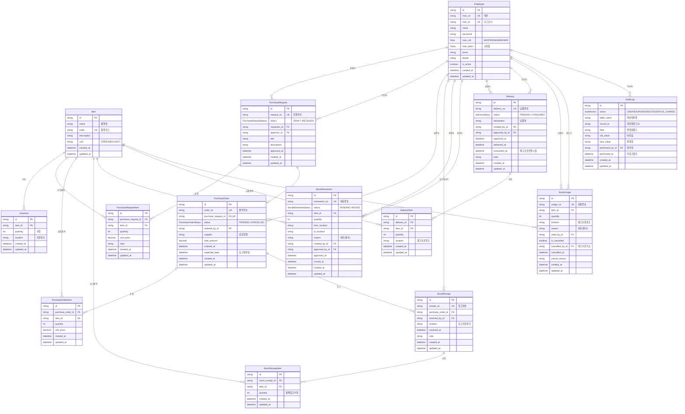

# IMS - Entity Relationship Diagram

## ERD (Mermaid)



## 테이블 설명

### 사용자/권한

| 테이블 | 설명 |
|--------|------|
| **Employee** | 직원 정보. 직번(man_no), 로그인ID(man_id), 역할(MASTER/ADMIN/USER), 소속팀을 관리. 경영지원팀은 전체 데이터 접근, 나머지 팀은 소속 팀 데이터만 접근 |

### 마스터 데이터

| 테이블 | 설명 |
|--------|------|
| **Item** | 품목 마스터. 품목코드, 품목명, 단위 등 품목의 기본 정보 관리 |
| **Inventory** | 재고 현황. 품목별, 보관장소별 현재 수량 관리. (item_id + location) 복합 유니크 |

### Flow 1: 구매 Flow

| 테이블 | 설명 |
|--------|------|
| **PurchaseRequest** | 구매요청. DRAFT -> PENDING -> APPROVED -> ORDERED -> RECEIVED 상태 흐름 |
| **PurchaseRequestItem** | 구매요청 품목. 구매요청에 포함된 개별 품목과 수량 |
| **PurchaseOrder** | 발주. 구매요청 승인 후 생성되며 1:1 관계. 공급업체, 총금액 등 관리 |
| **PurchaseOrderItem** | 발주 품목. 발주에 포함된 개별 품목, 수량, 단가 |
| **StockReceipt** | 입고. 발주 후 실제 물품 입고 처리. 입고 보관장소 지정 |
| **StockReceiptItem** | 입고 품목. 실제 입고된 품목별 수량 |

### Flow 2: 재고이동 Flow

| 테이블 | 설명 |
|--------|------|
| **StockMovement** | 재고이동. PENDING -> APPROVED -> MOVED 상태 흐름. 출발지/목적지, 사유 필수 |

### Flow 3: 납품 Flow

| 테이블 | 설명 |
|--------|------|
| **Delivery** | 납품. PENDING -> IN_PROGRESS -> DELIVERED -> APPROVED -> CONSUMED 상태 흐름. 승인 후 재고 소진 반영 |
| **DeliveryItem** | 납품 품목. 납품에 포함된 개별 품목, 수량, 출고 보관장소 |

### Flow 4: 재고사용 Flow

| 테이블 | 설명 |
|--------|------|
| **StockUsage** | 재고사용. 승인 없이 즉시 재고 차감. 사유 필수, 취소는 마스터(MASTER) 역할만 가능 |

### 공통

| 테이블 | 설명 |
|--------|------|
| **AuditLog** | 감사 로그. 모든 변경 이력 추적. 처리자, 타임스탬프, 대상 테이블/레코드, 이전값/변경값 기록 |

## 상태 흐름도

### 구매요청 (PurchaseRequest)
```
DRAFT → PENDING → APPROVED → ORDERED → RECEIVED
```

### 발주 (PurchaseOrder)
```
PENDING → CONFIRMED → SHIPPED → RECEIVED
                                     ↘ CANCELLED (언제든 취소 가능)
```

### 재고이동 (StockMovement)
```
PENDING → APPROVED → MOVED
```

### 납품 (Delivery)
```
PENDING → IN_PROGRESS → DELIVERED → APPROVED → CONSUMED
```
- APPROVED 이후 재고 소진(차감) 반영

### 재고사용 (StockUsage)
```
생성 즉시 재고 차감 (승인 불필요)
취소: 마스터(MASTER) 권한만 가능
```
